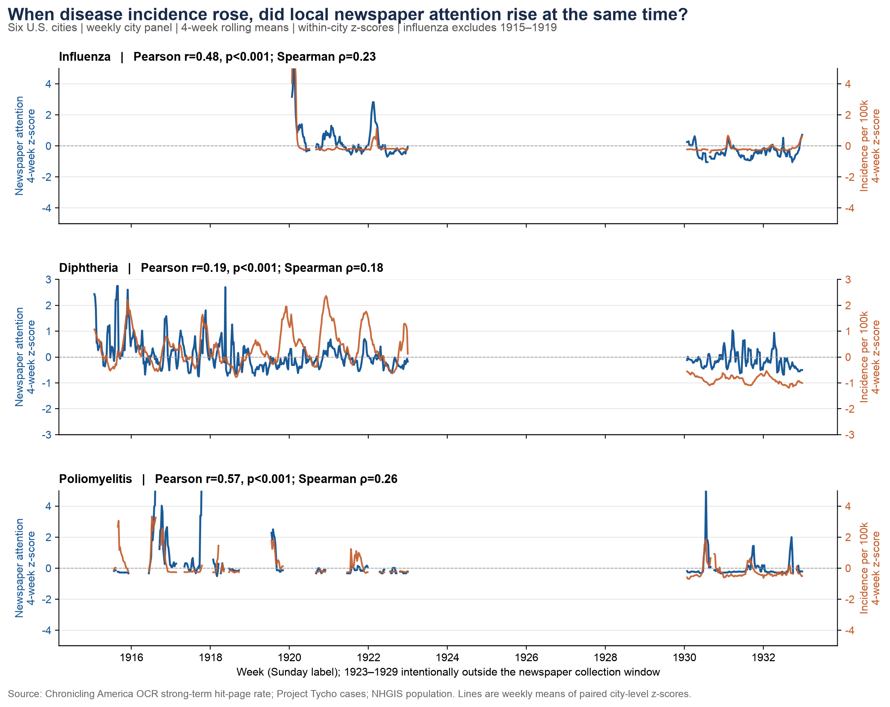

# Q1 疫情增加时地方报刊关注是否同步上升

周莉婕｜报刊 OCR 负责人｜六城｜1915–1922 年与 1930–1932 年｜2026-10-30

## 结论

在按小组统一口径做 4 周滚动均值和城市内 z-score 后，三种疾病的报刊强词关注度与每 10 万人发病率在六城池化样本中均呈显著正相关，但不能简化为“各城市都同步上升”。白喉是弱而较稳健的正关联；流感和脊灰的 Pearson 系数较高，但 Spearman 明显较低，说明结果较多受疫情高峰及个别城市驱动。

| 病种 | 成对城市周 | Pearson r | p | Spearman ρ | p | 解释 |
|---|---:|---:|---:|---:|---:|---|
| 流感 | 911 | 0.479 | <0.001 | 0.230 | <0.001 | 总体正相关，但秩相关明显减弱，高峰和城市差异影响较大 |
| 白喉 | 2,893 | 0.186 | <0.001 | 0.183 | <0.001 | 弱正相关，两种方法接近，稳健性相对最好 |
| 脊髓灰质炎 | 718 | 0.572 | <0.001 | 0.265 | <0.001 | Pearson 中度偏强，但 Spearman 较低，主要反映若干流行高峰 |

## 城市差异与稳健性

- 流感：纽约、华盛顿和巴尔的摩为明显正相关；克利夫兰接近 0；洛杉矶仅弱正相关。密尔沃基 Pearson 很高，但只有 32 个成对周，且 Spearman 未达 0.05 阈值，不宜单独强调。
- 白喉：多数城市为正相关，但洛杉矶呈负相关（Pearson -0.197；Spearman -0.502），说明语种、报纸更替和覆盖结构可能改变结果。
- 脊灰：洛杉矶、密尔沃基和纽约的正相关较强，克利夫兰接近 0。
- 强词＋弱词敏感性分析中，三种疾病的方向均未改变；Pearson 依次为 0.489、0.153 和 0.499。脊灰相关程度下降，说明弱词 `polio` 的歧义会影响强度，主结果使用强词的决定是合理的。

## 方法与限制

报刊指标为强词命中页数除以当周扫描页数。报刊命中率和发病率先按城市和连续周做 4 周滚动均值，再在城市内标准化。流感分析整段排除 1915–1919 年；所有缺失值均保留为 NA。结果只支持媒体关注与疫情强度的关联，不支持因果结论。各城报纸语种、出版频率和覆盖差异较大；池化 p 值也未针对时序自相关做模型修正，因此属于探索性结果。

**数据来源：** Library of Congress Chronicling America OCR、Project Tycho 疫情记录、IPUMS NHGIS 人口；交接包六城周级融合表。
