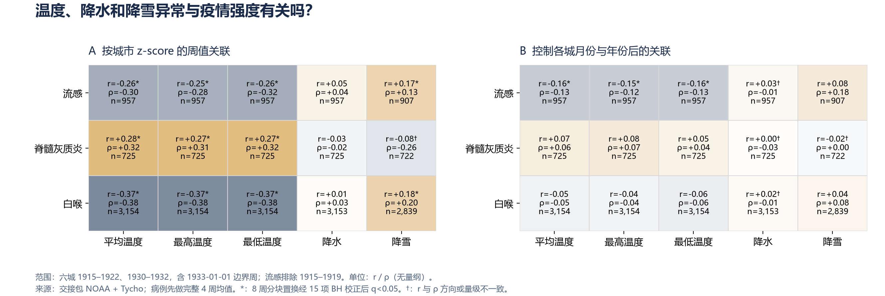

# Q3 结果：气候异常与疫情强度

日期：2026-10-31。输入：融合主表 3,450 行 × 29 列；原始读取 `utf-8-sig`。

## 可直接供整合的结论

流感：平均温度主分析 r=-0.260、ρ=-0.302（n=957）；月份/年份调整后 r=-0.164、q=0.0050。

脊髓灰质炎：平均温度主分析 r=+0.277、ρ=+0.316（n=725）；月份/年份调整后 r=+0.074、q=0.2760。

白喉：平均温度主分析 r=-0.371、ρ=-0.383（n=3154）；月份/年份调整后 r=-0.047、q=0.1200。

降水：三病种主分析及调整后均未见校正后显著关联。降雪：流感、白喉主分析为弱正相关，但控制月份/年份后证据减弱；脊灰的 Pearson 与 Spearman 量级不同，不作稳定结论。

上述为历史报告病例的描述性关联。周值 z-score 保留了季节周期，不能直接称为“超出季节常态的异常效应”；控制月份与年份的结果用于判断这一区别。Pearson 与 Spearman 异号或相差 >0.15 的单元格标为“差异需注明”，不作稳定关联结论。统计显著与效应大小分别解释，不据此推断因果。



## 处理口径

1. 按 `city × sunday_date` 唯一键排序，研究主窗口沿用交接表；1933-01-01 是额外边界标签，保留并做剔除敏感性。1923–1929 为设计外时期，不补入分析。
2. 流感分析先整段排除 1915–1919，包括纽约 1919 年尾已有记录；其他病种保留全表。病例缺失一律 NA，不当零病例。
3. 每城重建完整周日历后，病例做向后看的 4 周均值（含当周，`min_periods=4`）。任何一周缺失则该滚动结果为 NA，不能跳过缺周或跨七年空档平滑。气象使用当周值，不另平滑。
4. 每个病种的可用研究窗口内，气象与平滑病例分别按城市 z-score，`ddof=0`。主结果合并标准化后的城市周，按每项指标成对剔除 NA；因此有效周更多的城市权重更大。z-score 是相对本研究窗口的标准化周值，不是 30 年气候常年距平。
5. 相关：Pearson 为主，Spearman 对照。普通独立样本 p 仅供对照（CSV 的 `*_p_iid`），不能忽略平滑和时序相关。主图标记使用城市×连续窗口内 8 周分块置换，B=999，双侧 p=(1+更极端次数)/(B+1)，固定种子 20261031。NA 随病例块一起移动，短尾块保留。此置换依赖块交换近似，属于探索性推断。
6. 主分析与月份/年份调整各自对 3 病种×5 气象变量的 15 项 p 做 BH 校正。p<0.05 为名义阈值，图中 * 用 q<0.05；0.05≤q<0.10 仅记边缘证据，不称显著。
7. 调整版在每城有效配对样本内，分别用月份与年份虚拟变量残差化气象和病例，再分别标准化后相关。该调整只控制粗粒度季节和年度差异，不能排除所有混杂。

## 完整结果

| 处理 | 病种 | 气象 | n | pearson_r | spearman_rho | p_block | q_block_bh | agreement |
|---|---|---|---|---|---|---|---|---|
| 主分析 | 流感 | 平均温度 | 957 | -0.260 | -0.302 | 0.001 | 0.002 | 一致 |
| 月份+年份调整 | 流感 | 平均温度 | 957 | -0.164 | -0.133 | 0.001 | 0.005 | 一致 |
| 主分析 | 流感 | 最高温度 | 957 | -0.252 | -0.284 | 0.001 | 0.002 | 一致 |
| 月份+年份调整 | 流感 | 最高温度 | 957 | -0.153 | -0.119 | 0.001 | 0.005 | 一致 |
| 主分析 | 流感 | 最低温度 | 957 | -0.259 | -0.317 | 0.001 | 0.002 | 一致 |
| 月份+年份调整 | 流感 | 最低温度 | 957 | -0.155 | -0.128 | 0.001 | 0.005 | 一致 |
| 主分析 | 流感 | 降水 | 957 | 0.050 | 0.040 | 0.203 | 0.234 | 一致 |
| 月份+年份调整 | 流感 | 降水 | 957 | 0.028 | -0.006 | 0.462 | 0.533 | 差异需注明 |
| 主分析 | 流感 | 降雪 | 907 | 0.173 | 0.128 | 0.018 | 0.025 | 一致 |
| 月份+年份调整 | 流感 | 降雪 | 907 | 0.081 | 0.177 | 0.137 | 0.228 | 一致 |
| 主分析 | 脊髓灰质炎 | 平均温度 | 725 | 0.277 | 0.316 | 0.001 | 0.002 | 一致 |
| 月份+年份调整 | 脊髓灰质炎 | 平均温度 | 725 | 0.074 | 0.063 | 0.184 | 0.276 | 一致 |
| 主分析 | 脊髓灰质炎 | 最高温度 | 725 | 0.273 | 0.306 | 0.001 | 0.002 | 一致 |
| 月份+年份调整 | 脊髓灰质炎 | 最高温度 | 725 | 0.082 | 0.071 | 0.130 | 0.228 | 一致 |
| 主分析 | 脊髓灰质炎 | 最低温度 | 725 | 0.273 | 0.322 | 0.001 | 0.002 | 一致 |
| 月份+年份调整 | 脊髓灰质炎 | 最低温度 | 725 | 0.054 | 0.037 | 0.347 | 0.434 | 一致 |
| 主分析 | 脊髓灰质炎 | 降水 | 725 | -0.032 | -0.020 | 0.497 | 0.532 | 一致 |
| 月份+年份调整 | 脊髓灰质炎 | 降水 | 725 | 0.005 | -0.029 | 0.924 | 0.924 | 差异需注明 |
| 主分析 | 脊髓灰质炎 | 降雪 | 722 | -0.084 | -0.259 | 0.095 | 0.119 | 差异需注明 |
| 月份+年份调整 | 脊髓灰质炎 | 降雪 | 722 | -0.019 | 0.002 | 0.669 | 0.717 | 差异需注明 |
| 主分析 | 白喉 | 平均温度 | 3154 | -0.371 | -0.383 | 0.001 | 0.002 | 一致 |
| 月份+年份调整 | 白喉 | 平均温度 | 3154 | -0.047 | -0.053 | 0.040 | 0.120 | 一致 |
| 主分析 | 白喉 | 最高温度 | 3154 | -0.369 | -0.380 | 0.001 | 0.002 | 一致 |
| 月份+年份调整 | 白喉 | 最高温度 | 3154 | -0.039 | -0.044 | 0.056 | 0.140 | 一致 |
| 主分析 | 白喉 | 最低温度 | 3154 | -0.367 | -0.379 | 0.001 | 0.002 | 一致 |
| 月份+年份调整 | 白喉 | 最低温度 | 3154 | -0.056 | -0.063 | 0.016 | 0.060 | 一致 |
| 主分析 | 白喉 | 降水 | 3153 | 0.015 | 0.026 | 0.843 | 0.843 | 一致 |
| 月份+年份调整 | 白喉 | 降水 | 3153 | 0.019 | -0.013 | 0.306 | 0.417 | 差异需注明 |
| 主分析 | 白喉 | 降雪 | 2839 | 0.177 | 0.195 | 0.001 | 0.002 | 一致 |
| 月份+年份调整 | 白喉 | 降雪 | 2839 | 0.038 | 0.082 | 0.093 | 0.199 | 一致 |

## 敏感性

`补充材料/sensitivity.csv` 与 `补充材料/sensitivity_comparison.csv` 含不平滑、质量筛选、严格质量筛选、人均病例、log1p、前/后移气象一周、删除边界周 8 类 × 15 项结果；这里只比较 r、ρ、n，不为每项额外制造显著性结论。

- 质量筛选：气象当周 `n_days≥6.5` 且 `n_stations≥该城窗口内25%分位数`；严格筛选用 `n_days≥7` 且站数≥城市中位数。各城相对阈值避免直接排除历史站网较小的纽约/华盛顿。阈值是本次分析约定，不是 NOAA 官方质控标准。质量筛选作用于气象周，病例仍按原有效日历平滑。
- 人均敏感性从病例/插值人口×100,000 以完整精度计算，再平滑与标准化，避免主表四舍五入后的稀疏小值；人口并非逐周实测。
- `weather_prev_week`：把气象日期加 7 天后与病例周匹配；`weather_next_week` 相反。不跨研究窗口插入外部气象，也不能据此定义因果方向。
- 城市分层结果见 `补充材料/city_correlations.csv` 与城市对比图，常数/有效配对不足时不计算相关。
- 对数敏感性使流感与平均温度 r 从-0.260变为-0.492，方向一致但量级不稳定，提示极端病例/偏态会影响线性相关强度；不能笼统写“所有口径均稳健”。站点质量筛选最大|Δr|约0.020，严格筛选约0.032，人口口径约0.009，删除边界周约0.0045。城市样本不均，例如密尔沃基流感只有36个平滑有效周，巴尔的摩脊灰温度r接近0；六城不能视作同质重复样本。

| variant | max_abs_delta_r | min_n | max_n |
|---|---|---|---|
| exclude_boundary | 0.0045 | 720 | 3148 |
| log1p | 0.2419 | 722 | 3154 |
| per100k | 0.009 | 722 | 3154 |
| quality | 0.0197 | 658 | 2885 |
| strict_quality | 0.0324 | 621 | 2662 |
| unsmoothed | 0.0543 | 1287 | 3371 |
| weather_next_week | 0.0477 | 720 | 3142 |
| weather_prev_week | 0.0358 | 721 | 3154 |

## 缺失、溯源与局限

| disease | raw_non_na | smoothed_non_na |
|---|---|---|
| diph | 3371 | 3154 |
| flu | 1363 | 957 |
| polio | 1446 | 725 |

NOAA 温度三列覆盖全表；降水 1 个 NA；降雪 338 个 NA，洛杉矶 291、密尔沃基 47。本次补充原始宽表后已补齐六城映射、站点坐标和站距，详见NOAA源卡；原清洗脚本和导出配置仍未提供。PRCP/SNOW已确认先按各站该周有效日求日均、再跨站平均，不是周累计量；字段单位和原始质量标志处理仍待补证，因此图用无量纲标准化值，不将现有数值换算成物理效应。站数敏感性不能代替站点级重建。

重建脚本从 cleaned 表逐格复现主表，检查 NA 掩码及全部 29 列；原始采集/清洗的复现仍需原作者脚本与 raw。主表报刊分母与跨报纸汇总存在继承口径差异，已单列 GAPS，不影响本题 NOAA×Tycho 的计算。

## 复现

```powershell
python -m pip install -r requirements.txt
python scripts/build_integrated.py --check
python scripts/run_q3.py
```

完整数据、脚本、依赖版本、输入 SHA256 与核验结果见 `run_manifest.json`、`rebuild_check.json`、`verification.json`。